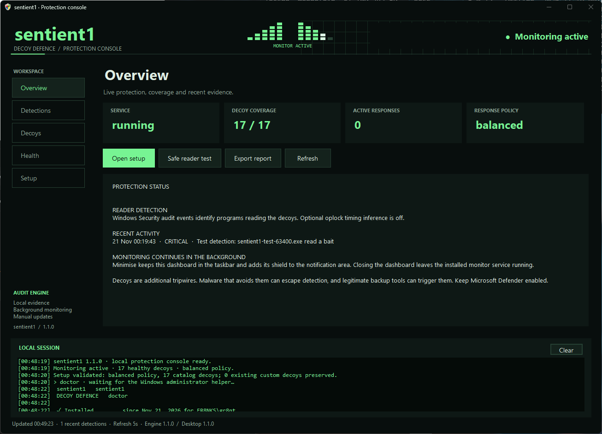

# sentient1

**Windows decoy defence with a native protection console.**

sentient1 plants monitored decoy credentials, wallets and application profiles.
When a program reads one, it records the reader's identity and evidence, then
applies the response policy you chose. Review detections, configure protection
and run diagnostics from one dark, green-terminal interface.

[Download Windows v1.1.0](https://github.com/xak1234/sentient1/releases/tag/v1.1.0) ·
[Detection method](#how-file-reads-are-detected) · [Security model](SECURITY.md) ·
[Changelog](CHANGELOG.md)



Based on the MIT-licensed [A Better Antivirus (ABA)](https://github.com/vulnix0x4/a-better-antivirus)
engine. The original attribution and licence are retained. This is an independent
project, with its own desktop, service identity, validation and recovery changes.

## Run

1. Download and extract **sentient1_1.1.0_Windows_x64_Source.zip** from the release.
2. Install the [.NET 8 Desktop Runtime x64](https://dotnet.microsoft.com/en-us/download/dotnet/8.0) if it is not already present.
3. Open **sentient1-Desktop.exe**, choose **Setup**, review the options and apply.

On Windows 10/11 x64, open **`sentient1-Desktop.exe`** in the release folder.
Keep `sentient1.exe` beside it. The desktop needs **.NET 8 Desktop Runtime x64**;
the Windows Desktop Runtime is required, not just the base .NET runtime. The
Go engine is standalone. Source builds need Go 1.27.4 and .NET SDK 8.0.

Open **Setup** in the left navigation to review policy, learning days, available
decoys, optional oplock inference and notification settings. **Validate settings**
checks the choices without changing protection. **Review & apply** shows a
confirmation in the same window, then requests Windows administrator permission.
Progress streams into the green activity terminal. Existing custom decoys and
notification credentials are preserved unless you choose to change them.

After installation, **Safe reader test** exercises detection with a harmless
reader and sends test alerts to any configured notification provider. No real
malware is included. Minimising keeps the running application in the taskbar and
adds its shield to the notification area; double-click the shield to restore it.
Closing the dashboard leaves the installed monitor service running.

The default is Balanced: critical readers can be frozen and blocked from the
network; lower-severity detections notify. For an initial observation period,
choose **Alert only**. Strict may isolate the whole computer. Learning only
postpones lower-severity responses; critical responses remain active.

The header's paired green block staircases animate up, pause across the gap,
then animate down on the opposite side. They reflect a running monitor with a
recent heartbeat. They dim when monitoring stops, a command is running or status
becomes stale. This is a status indicator, not a count of scanned files.

Native scrollbar tracks are hidden throughout the interface. Use the mouse
wheel, arrow keys, Page Up/Page Down and Home/End to move through content.
Setup scrolls the whole page when its background is focused; tables and text
panes scroll their own content when focused. Tab brings setup fields into view.

## How file reads are detected

The default method uses Windows file auditing. sentient1 adds audit rules (SACLs)
to its decoys and subscribes to Security event **4663**. A recorded `FILE_READ_DATA`
access supplies the file, executable and process ID. The engine collects process,
publisher, hash and ancestry evidence, then classifies the event and applies the
configured response policy.

Optional opportunistic locks (oplocks) add a faster timing signal. Windows breaks
the lock when a competing open occurs; thread timing is then used to infer the
reader. That inference can be wrong, so it is off by default and labelled in the
UI. An audited read proves access, not malicious intent. There is no trained AI
classifier or general executable-signature scanner in this project.

## What is improved

| Area | sentient1 behaviour |
|---|---|
| Desktop | Dark charcoal/green native console with Overview, Detections, Decoys, Health and Setup navigation; embedded terminal; five-second refresh; severity and text filters. |
| Evidence | Reader path, hash, publisher, process ancestry, decoys, timestamps and response results. Audit events and oplock inference are labelled separately. |
| Health | A running service alone cannot produce a healthy status. Recent heartbeat, verified file auditing and healthy audited decoys are required. Failed checks remain visible. |
| Identification | Windows audit events are the default. Timing-based oplock inference is optional, off by default. |
| Oplock readiness | Counts actual granted locks rather than requested watchers, avoiding a false armed count for missing or busy files. |
| Delayed events | Detects when a recorded access predates the current process with that PID; preserves historical evidence without acting on that reused PID. |
| Recovery | Failed undo operations retain retry information, return errors and leave the alert unresolved. Successful operations cannot clear a newer incident's state snapshot. Unknown recorded process creation time refuses resume/kill. |
| Alert storage | Rejects traversal, stream names and invalid IDs; new IDs use 64 random bits rather than 16. |
| Reports | Offline HTML and JSON, escaped HTML evidence, no remote assets, command lines omitted by default. Raw local evidence remains intact. |
| Independence | Separate service, data directory, mutex and WFP identities. No inherited upstream update repository or signing key. |

## Desktop controls

- **Setup**: install or reconfigure using native controls in the main window. Stale settings, invalid dependencies and unavailable real-app profiles are rejected.
- **Safe reader test**: harmless reader test after the service has been installed.
- **Diagnostics / Repair**: verify monitor health, or repair it with administrator rights.
- **Export report**: choose HTML or JSON. Paths and network addresses are retained;
  command lines, decoy contents and notification secrets are not exported by default.
- **Resume once**: release the selected reader without adding permanent trust.
- **Trust reader**: add the engine's narrow, evidence-based trust rule.
- **Kill frozen**: terminate the selected incident's frozen processes.
- **Release all**: explicitly undo sentient1 containment after investigation.

Response confirmations and command output stay inside the dashboard. The main
window runs without elevation; administrative operations use a short-lived
Windows UAC helper. A private named pipe with an account ACL and process-ID
verification carries the allowlisted operation and results. Credentials are sent
in memory, not placed in command-line arguments or temporary setup files.
The shield is embedded in the executable so Windows can use it for pinned
shortcuts as well as running windows. Pin `sentient1-Desktop.exe` from its stable
release folder. If Windows retained an older blank icon, unpin that old shortcut
and pin the updated application once.

## CLI examples

```powershell
.\sentient1.exe --version
# sentient1 1.1.0

.\sentient1.exe status --json
# Before installation: product="sentient1", installed=false,
# service="not installed", assessment.title="Not installed".

.\sentient1.exe install
.\sentient1.exe test
.\sentient1.exe doctor
.\sentient1.exe alerts
.\sentient1.exe policy alert
.\sentient1.exe report --output incident.html
.\sentient1.exe report --format json --output incident.json
.\sentient1.exe release
.\sentient1.exe uninstall
```

For the advanced oplock inference option: `sentient1.exe instant on` or `off`.
It uses thread timing and undocumented Windows internal layouts, so it is not a
proof of which process opened a file. The audit path remains enabled. Neither
path guarantees prevention of data already sent before a response.

Use `sentient1.exe bait show <id>` to inspect stored decoy content without reading
and triggering the planted file. Existing application profiles are detected and
not replaced by decoys; installing the real app later retires that decoy.

## Local footprint

- Program and service binary: `C:\Program Files\sentient1 Monitor`
- Windows service: `sentient1Monitor` (LocalSystem)
- Config, state, alerts and service log: `C:\ProgramData\sentient1Monitor`
- Decoys: selected user folders and unused application profile locations
- File auditing: Windows File System audit policy and per-decoy audit rules
- Response filters: sentient1-specific Windows Filtering Platform provider

Avoid activating both ABA and sentient1 over the same decoy files; shared file ownership/audit-policy restoration
has not been tested. This release is manually distributed and not code-signed.
`SHA256SUMS.txt` detects accidental changes; it is not a signing certificate.
`sentient1 update --check` explains that no update channel is configured and
makes no request. Optional phone notifications and canary tokens contact their
configured providers only when explicitly configured.

## Build and verify

```powershell
.\scripts\build.ps1
```

This runs Go formatting verification, `go vet`, the Go tests, a release Go build,
.NET compilation with nullable analysis and warnings treated as errors, and
.NET formatting/analyzer verification. It copies documentation, third-party
licences and executable SHA-256 checksums into `dist`.

The source tests exercise parsing, classification, trust, recovery, health,
report escaping/redaction, PID reuse and Windows oplocks. The admin-only tests
below temporarily enable file auditing, restore its previous setting, and block
only a private temporary copy of curl, then remove their filters:

```powershell
$env:SENTIENT1_INTEGRATION = '1'
go test -count=1 -v ./internal/integration -run '^(TestBaitReadIsDetected|TestBlockProgram)$'
Remove-Item Env:SENTIENT1_INTEGRATION
```

Use a disposable VM for the broader upstream `scripts/e2e.ps1` and full
integration suite: they install services and exercise host isolation.

## Module map

- `cmd/sentient1`, `internal/cli`: entry point, setup and control commands.
- `internal/baits`, `winsec`, `evtlog`: decoys, Windows audit rules and event parsing.
- `internal/engine`, `classify`, `trust`: attribution, severity, sweep detection,
  forensic evidence and narrow trust rules.
- `internal/instant`: optional oplock inference and actual lock readiness.
- `internal/protection`: shared conservative health assessment.
- `internal/review`: dashboard snapshots and safe HTML/JSON export.
- `internal/respond`, `netguard`: response recovery and program/network filters.
- `internal/service`, `config`, `svcctl`: service lifecycle and persisted state.
- `internal/cli/desktop.go`: bounded structured setup input, revision/account validation and progress output.
- `desktop/MainForm.cs`, `Theme.cs`, `ActivitySignal.cs`: native navigation, dark/green styling, live evidence, terminal and taskbar/tray handling.
- `desktop/SetupView.cs`: policy, decoys and notification configuration in the main window.
- `desktop/Engine.cs`: hidden CLI processes and authenticated, allowlisted UAC helper.
- `desktop/Program.cs`: desktop/worker entry points and real-application smoke checks.

## Coverage limits

This is an additional tripwire, not a full antivirus or a guarantee that a PC is
clean. Malware that does not touch the decoys can bypass it; administrator-level
malware can tamper with it; legitimate backup/indexing tools can trigger it.
Keep Microsoft Defender enabled. This release has not been benchmarked against
a live malware corpus. Read `SECURITY.md` and `docs/REVIEW.md` for scope and
remaining limitations.

## Minimal desktop checks

```powershell
.\sentient1-Desktop.exe --smoke-test
Get-Content .\desktop-smoke-test.txt
# PASS: native pages, shield, taskbar, real engine snapshot and worker allowlist.

.\sentient1-Desktop.exe --ui-test
# Opens the real UI, validates saved settings without applying them, runs
# read-only diagnostics through the UAC helper, minimises and restores.
# Allow the Windows administrator prompt if shown, then inspect:
Get-Content .\desktop-ui-test.txt
# PASS: all five pages; real setup validation; elevated diagnostics streamed in-window; minimise/taskbar/tray/restore; hidden scrollbars with wheel/keyboard navigation.
```

The UI check requires a configured monitor owned by the current Windows user.
The Go validation tests also cover stale revisions, changed user identity, real
application profiles, dependent decoy selection, empty selection and bounded JSON.
