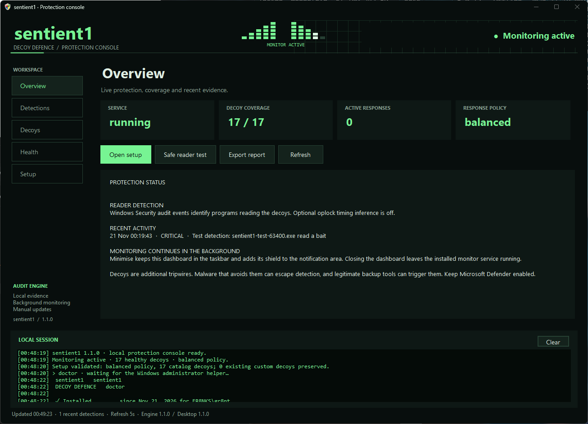

# sentient1 1.1.0

Windows decoy defence with integrated setup, local evidence review and a green
terminal interface. This is the first published sentient1 GitHub release.

## Download and run

Download **sentient1_1.1.0_Windows_x64_Source.zip**, extract it, and open
**sentient1-Desktop.exe**. Keep **sentient1.exe** beside it. Windows 10/11 x64 and
**.NET 8 Desktop Runtime x64** are required. Open **Setup** to review the decoys and
response policy before applying. Windows requests administrator permission for
administrative operations.

The ZIP contains both executables, full source, build/packaging scripts, licence
notices and documentation. SHA-256 checksums are provided alongside the ZIP and
inside it for the executables. This release is not code-signed.

## Included

- One-window navigation, setup, confirmations and streamed command output.
- Dark charcoal/green styling and paired stepped activity indicators.
- Embedded taskbar shield, normal minimise behaviour and notification-area restore.
- Mouse-wheel and keyboard navigation with native scrollbar tracks hidden.
- Windows audit-based reader identification; optional oplock inference is off by default.
- Local detection evidence and HTML/JSON exports; reversible response controls.
- Account/revision-aware setup validation, recovery safeguards and PID reuse checks.

## Validation

Windows Go formatting, vet and ordinary tests passed. The .NET desktop compiled
with nullable analysis and warnings treated as errors; formatting/analyzer checks
passed. Real UI checks validated saved setup, streamed elevated diagnostics,
verified taskbar/tray restore, and exercised wheel and keyboard navigation.
A live installation remained healthy with 17 audited decoys and its configuration
unchanged. Selective real audit/WFP checks passed during initial development.

Decoys are an additional tripwire. Programs that never touch them can escape
detection, and legitimate software can trigger them. Keep Microsoft Defender
enabled. Full host isolation and a live malware corpus were not tested for this
release. See **SECURITY.md** and **docs/REVIEW.md** for scope and limitations.

Based on the MIT-licensed A Better Antivirus engine; attribution is retained.
